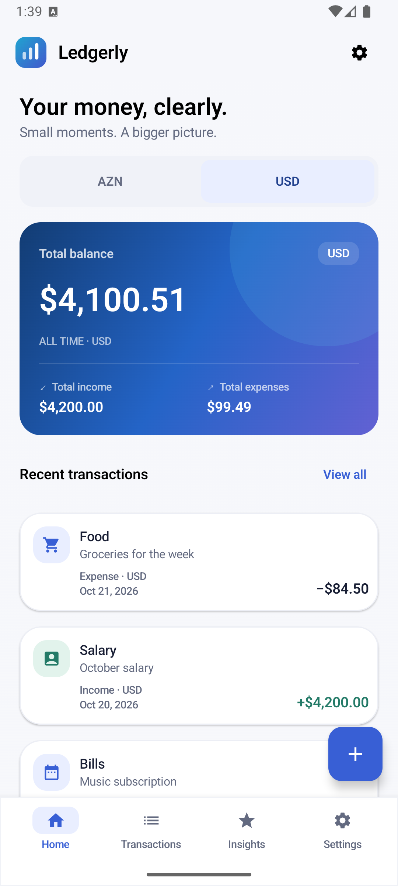
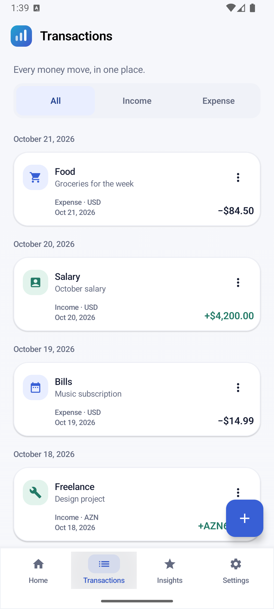
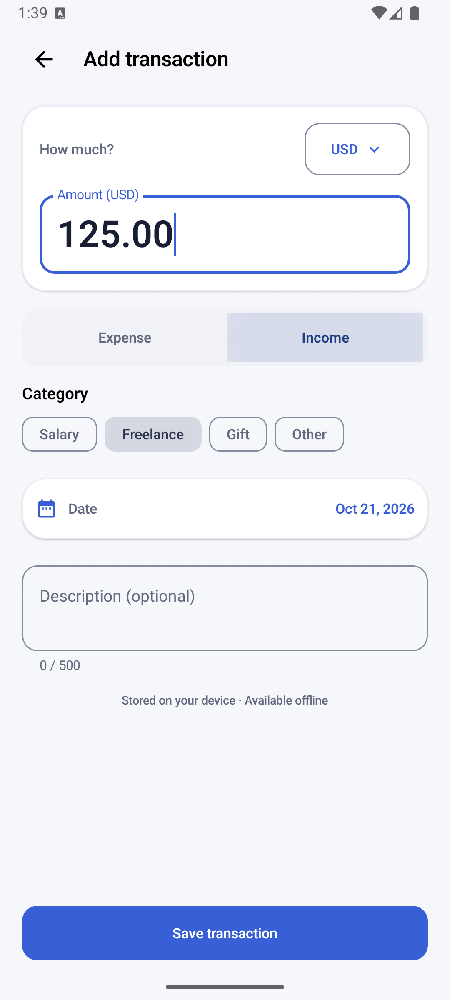
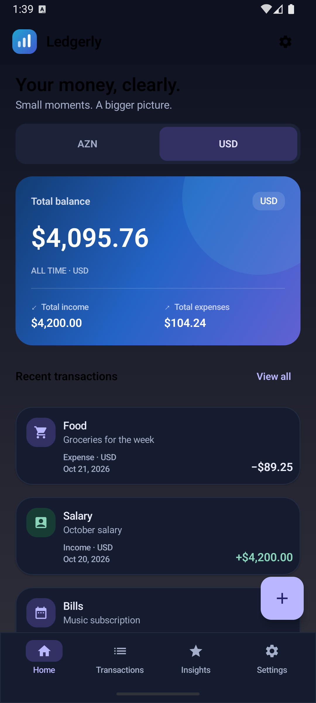
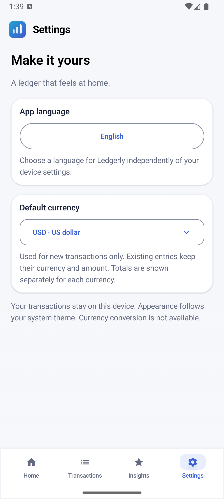
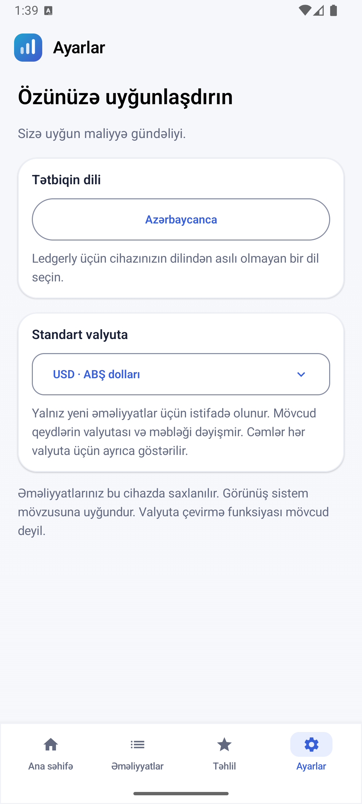
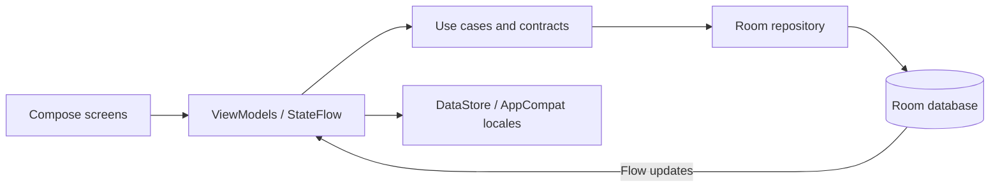

<div align="center">

# Ledgerly

### Your money, clearly.

A thoughtfully designed, offline-first Android finance app built with Kotlin and Jetpack Compose.
Track income and expenses, keep currencies separate, and make your ledger feel at home in four languages.


[Features](#features) · [Screenshots](#screenshots) · [Architecture](#architecture) · [Getting started](#getting-started) · [Testing](#testing)

</div>

## Features

- **Home dashboard** — a blue-gradient balance card, independent totals for each currency, and recent transactions.
- **Transaction history** — newest-first entries grouped by date, income/expense filters, editing, and deletion with confirmation.
- **Add and edit** — exact amounts, currency and category selectors, a date picker, optional notes, validation, and recoverable drafts.
- **Live local updates** — saving, editing, or deleting a transaction immediately updates the ledger through Room Flow.
- **Language preferences** — Azerbaijani, English, Russian, Turkish, or the system language, independent of the device language.
- **Currency preferences** — a persisted default for new transactions; existing entries keep their own ISO currency code and amount.
- **Refined interface** — shared Compose components, compact navigation, light/dark themes, blue/indigo gradients, subtle transitions and press feedback.
- **Accessible motion** — animations respect Android’s Remove animations setting. Monetary values are never interpolated through floating point.

## Screenshots

Actual Android API 36 emulator captures of the application, not mockups. The sample entries are created by an opt-in instrumentation test and are never included in production screens or seeded on app startup.

<table>
  <tr>
    <th>Home</th><th>History</th><th>Add transaction</th>
  </tr>
  <tr>
    <td></td>
    <td></td>
    <td></td>
  </tr>
  <tr>
    <th>Dark theme</th><th>Settings</th><th>Azerbaijani</th>
  </tr>
  <tr>
    <td></td>
    <td></td>
    <td></td>
  </tr>
</table>

## Languages and currencies

| Languages | ISO currency codes |
| --- | --- |
| Azərbaycanca (`az`) | Azerbaijani manat — `AZN` |
| English (`en`) | US dollar — `USD` |
| Русский (`ru`) | Euro — `EUR` |
| Türkçe (`tr`) | Russian ruble — `RUB` |

Language and currency are independent preferences. Numbers, money and dates use the selected app locale; user-written notes are preserved as entered.

### Financial correctness

- Each transaction stores a **positive `Long` amount in minor units**, an ISO currency code, and an income/expense direction.
- All four supported currencies use two decimal places. Input accepts a decimal point or comma and rejects ambiguous grouping or excess precision.
- Aggregates use **`BigInteger` minor units**, so many individually valid amounts cannot overflow a `Long` total.
- Balances are **grouped by currency**. USD and AZN, for example, are never added together.
- Formatting uses exact `BigDecimal` values and locale-aware `NumberFormat`.
- Changing the default currency affects only new drafts. Explicitly changing an existing entry’s currency corrects its denomination; it does **not** apply a conversion rate.
- Schema version **2** includes an explicit `1 → 2` migration assigning USD to legacy records. IDs, minor-unit amounts, dates, categories and descriptions are preserved. No destructive migration fallback is enabled.

## Tech stack

| Area | Implementation |
| --- | --- |
| Language and UI | Kotlin, Jetpack Compose, Material 3 |
| Architecture | MVVM, domain/data/UI package boundaries, repository contracts |
| Dependency injection | Hilt with KSP |
| Persistence | Room, exported schemas, explicit migration |
| State and concurrency | Coroutines, Flow, StateFlow, lifecycle-aware collection |
| Navigation | Navigation Compose |
| Preferences | Preferences DataStore; AppCompat per-app locales |
| Animation | Compose AnimatedContent, transitions, springs and animated list placement |
| Tests | JUnit 4, Coroutines Test, Compose UI tests, AndroidX Test, Room MigrationTestHelper |
| Build | Gradle Kotlin DSL, version catalog, AGP 8.9.1, Gradle 8.11.1 |

## Architecture

One app module keeps the project straightforward while separating responsibilities.



```text
app/src/main/java/com/jrustam/ledgerly/
├── data/                 # Room, mappings, migration and preference adapters
├── di/                   # Hilt bindings
├── domain/               # Models, contracts, validation and exact totals
└── ui/
    ├── addtransaction/   # Shared Add/Edit form and saved draft state
    ├── common/           # Locale-aware formatting and currency selection
    ├── design/           # Shared surfaces, toolbar, navigation and motion
    ├── overview/         # Dashboard, history, filtering and deletion
    ├── settings/         # Language and default-currency settings
    └── theme/            # Centralized light/dark palettes and typography
```

Room is the single source of truth. UI events pass through ViewModels and the domain layer; database invalidations update both Home and history. SavedStateHandle preserves editor drafts across recreation. Stable draft IDs make insert retries idempotent, while updates never recreate a transaction that was deleted during editing.

## Getting started

### Requirements

- Android Studio with **JDK 17**
- Android SDK **35** and compatible build tools
- An Android device or emulator running **API 24+**

```bash
git clone https://github.com/JRustam/Ledgerly.git
cd Ledgerly
./gradlew :app:assembleDebug
```

Open the repository root in Android Studio, let Gradle sync, select the `app` configuration, and run it on your device. Android Studio creates the machine-specific `local.properties` file; it is intentionally excluded from Git.

To install the debug APK manually:

```bash
adb install -r app/build/outputs/apk/debug/app-debug.apk
```

The repository uses the Gradle wrapper. No API keys, backend, login, exchange-rate service, or release signing keys are required. This is an actively developed application, not a Google Play release.

## Testing

```bash
# Compile, run JVM tests, and run Android lint
./gradlew :app:assembleDebug :app:testDebugUnitTest :app:lintDebug

# Run device tests on a dedicated emulator
./gradlew :app:connectedDebugAndroidTest \
  -Pandroid.injected.androidTest.leaveApksInstalledAfterRun=true
```

Tests cover exact balances, overflow-safe totals, currency separation, locale formatting, preference persistence, validation, draft restoration, retries, filtering, deletion errors, Room persistence and migration, and language selection across activity recreation.

The screenshot/core-flow test is opt-in and requires an **empty, disposable emulator ledger**. It creates and removes only its own fixture records and exercises editing, deletion confirmation, navigation, localization and dark mode:

```bash
./gradlew :app:connectedDebugAndroidTest \
  -Pandroid.testInstrumentationRunnerArguments.portfolioScreenshots=true \
  -Pandroid.injected.androidTest.leaveApksInstalledAfterRun=true
```

Captured PNGs are written to the app’s external `files/portfolio` directory. Standard instrumentation tooling can replace app installations, so use a dedicated emulator rather than a personal ledger.

Latest local verification and device configurations are recorded in [docs/VERIFICATION.md](docs/VERIFICATION.md). In restricted environments, `-Pkotlin.compiler.execution.strategy=in-process --no-watch-fs` avoids compiler-daemon filesystem restrictions.

## Privacy and offline behavior

Ledgerly has no application network permission, analytics SDK, login, or cloud backend. Transactions are stored in the app-private Room database; the default currency is stored in DataStore. Language persistence uses Android/AppCompat’s per-app locale mechanism.

Android system backup remains enabled from the original project and may include app data. Backup policy, optional encryption and release privacy documentation require review before a future store release. Do not treat the current build as an encrypted vault.

## Current scope and roadmap

Implemented: local transaction management, multi-currency totals, localization, preferences, themes and motion.

Planned, not implemented:

- Insights and spending charts; the Insights tab currently explains its future purpose.
- Search, richer filters and paging for large ledgers.
- User-controlled export/import and a deliberate backup policy.
- Release SDK/toolchain updates, expanded accessibility/device testing, and native-speaker translation review.
- Google Play release preparation and signing outside the repository.

There are no live exchange rates, currency conversion, cloud sync, login or premium features.

---

Built by [JRustam](https://github.com/JRustam) with Kotlin and Jetpack Compose.
