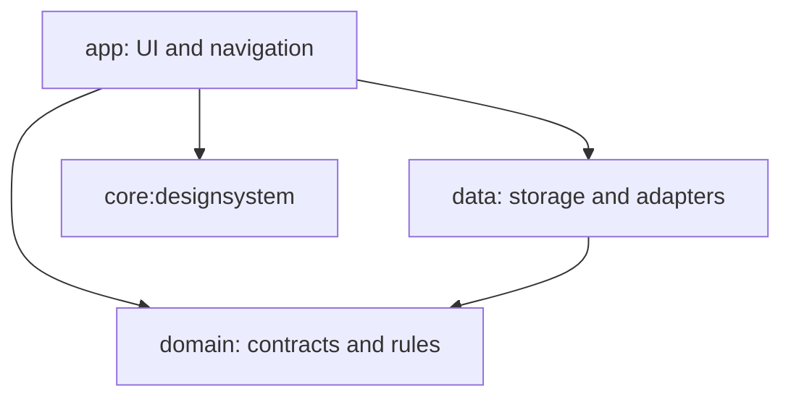

# Ledgerly

An offline-first personal finance application for Android, built with Kotlin, Jetpack Compose, and Material 3. Ledgerly keeps original amounts and currencies intact while helping you organize transactions, wallets, budgets, and savings goals.

> Development project, not a Google Play release. Milestones 1 (module boundaries) and 2 (domain/use cases) are complete. Historical verification results are documented in [Verification](docs/VERIFICATION.md).

## Implemented features

- Home dashboard with separate balances for each currency and a monthly cash-flow summary.
- Transaction creation, editing, deletion with confirmation, searchable history, and income/expense/currency filters.
- Manually managed cash, card, and bank wallets; opening-balance adjustments; transfers recording both sent and received amounts.
- Monthly category budgets, savings contributions and history-based completion estimates.
- Monthly recurring-payment schedules. These do not automatically record payments or send reminders.
- Monthly recap, category spending, six-month trends, and deterministic budget/spending comparisons based on stored records.
- Currency converter with user-initiated HTTPS reference-rate retrieval, dated offline cache, and explicit approximate/unavailable states.
- Transaction-only CSV export through Android's document picker, with quoting and spreadsheet-formula escaping.
- Onboarding, persisted language/default-currency/appearance preferences, light and dark themes, and reduced-motion support.
- My Profile with an editable display name, Android Photo Picker, removable circular avatar, and app-private photo storage. Photos are resized locally; no login or upload is involved.

Live bank connectivity is unavailable. The Connect Bank screen explains manual accounts; Ledgerly never requests full card numbers, CVV, PIN, or banking passwords.

## Languages and currencies

Languages: English, Azerbaijani, Russian, Turkish, Ukrainian, Serbian Latin, Serbian Cyrillic, French, German, and Arabic (RTL). The compact language picker uses native names and flag cues; language preferences remain independent of currency. Native-speaker review is still recommended. Spanish is not currently implemented.

Currencies: **AZN, USD, EUR, RUB, UAH, RSD**. Language and currency are independent preferences. Provider coverage for conversion can vary; unsupported pairs are reported as unavailable.

## Architecture

Gradle Kotlin DSL and a version catalog define four populated modules:

| Module | Responsibility | Project dependencies |
| --- | --- | --- |
| `:app` | Application entry point, screen ViewModels, navigation, screens, app resources and integration tests | `:domain`, `:data`, `:core:designsystem` |
| `:domain` | Android-independent models, repository contracts, transaction validation, exact calculations and financial rules | None |
| `:data` | Room entities/DAOs/repositories/migrations, DataStore and AppCompat adapters, exchange-rate cache, Hilt storage bindings | `:domain` |
| `:core:designsystem` | Shared Compose components, typography, light/dark colors and motion behavior | None |

Feature extraction is intentionally incremental. Screens remain in `:app`; no empty feature modules have been added. Domain types are organized into `model`, `repository`, `usecase`, and `calculation`; data types into `repository` and `local`. The Room database class identity remains stable.



Room is the source of truth for financial records. Coroutines, Flow and lifecycle-aware StateFlow collection propagate changes. Hilt supplies dependencies. DataStore persists currency, onboarding, appearance and cached-rate preferences; Android/AppCompat persists per-app languages.

### Financial correctness and compatibility

- Transactions store positive `Long` minor-unit amounts and ISO currency codes. All currently supported currencies have two fraction digits.
- Totals use `BigInteger`; conversions use `BigDecimal` and explicit rounding. Floating-point values are used only for drawing progress, never persisted money.
- Different currencies are never silently summed. Transfers do not count as income or expenses.
- Schema **v3** and exported v1/v2/v3 schemas live in `data/schemas`. Explicit migrations preserve records; no destructive fallback is configured.
- Database filename, database class identity, schema, DataStore filename and existing preference keys are preserved.
- Goal contributions track amounts set aside; they do not debit wallets. Opening-balance adjustments currently overwrite the baseline rather than create an audit entry.

### Domain operations and state ownership

`AddTransaction` and `EditTransaction` retain their existing validation and persistence behavior. The extracted operations are:

- `CalculateLedgerBalancesUseCase`: wallet baselines, transfers and unassigned legacy transactions, grouped by currency without double counting.
- `GetFinancialSummaryUseCase`: calendar-month totals, category breakdown, six-month trends, budget warnings and scheduled recurring totals.
- `ConvertCurrencyUseCase`: exact same-currency values, validated currency pairs, unavailable rates and explicitly approximate decimal conversions.
- `ExportTransactionsUseCase`: a consistent repository snapshot formatted as escaped CSV off the main dispatcher.

Finance and product ViewModels expose read-only StateFlow. Financial reports are prepared on the Default dispatcher; Compose renders those results. Product preferences and exchange rates are accessed through domain contracts. CSV export is coordinated by its own ViewModel and Android document writer; navigation no longer performs file I/O or currency conversion. Cancellation guards prevent older exchange requests from clearing a newer request's loading state.

## Build and run

Requirements: Android Studio, JDK 17 or a compatible bundled JDK, Android SDK 35, and a device/emulator on API 24+.

```bash
git clone https://github.com/JRustam/Ledgerly.git
cd Ledgerly
./gradlew :app:assembleDebug
adb install -r app/build/outputs/apk/debug/app-debug.apk
```

Open the repository root in Android Studio and run the `app` configuration. Local SDK configuration and signing material are excluded from Git. No API keys or backend are needed.

## Verification

Latest profile and source-organization changes were checked with the debug build only. Unit tests, instrumentation tests, and lint were not run for this update.

```bash
# Build, run JVM tests in their owning modules, and verify module boundaries
./gradlew :app:assembleDebug :app:testDebugUnitTest :domain:test validateModuleDependencies

# Lint Android modules
./gradlew :app:lintDebug :data:lintDebug :core:designsystem:lintDebug

# Compile integration tests without requiring a device
./gradlew :app:assembleDebugAndroidTest

# Execute device tests on a disposable emulator
./gradlew :app:connectedDebugAndroidTest \
  -Pandroid.injected.androidTest.leaveApksInstalledAfterRun=true
```

The portfolio flow is opt-in: add `-Pandroid.testInstrumentationRunnerArguments.portfolioScreenshots=true`. It requires an empty transaction/wallet database, creates synthetic fixtures in test code only, and attempts cleanup afterward. Use a disposable emulator, never a personal ledger. Existing device-test runtime failures remain under investigation; test APK compilation alone is not a passing device test.

The module dependency validation task rejects unexpected project dependencies and cycles. Test/build results and limitations are recorded in [docs/VERIFICATION.md](docs/VERIFICATION.md).

## Privacy

Finance records stay in the app-private database. Currency refresh sends selected currency codes to [Frankfurter](https://frankfurter.dev/) over HTTPS, not transaction records. There is no analytics SDK, account login, or application cloud-sync service.

Android system backup is enabled and may include application data. Backup exclusions, encryption, optional biometric locking, and release privacy documentation need review before a store release. CSV export includes transactions only; it is not a full backup/restore format.

## Remaining work

- Device verification of the updated Settings and My Profile screens, including photo selection and restart persistence.
- Recoverable startup preference failures.
- Device verification of v1 → v3 migration and a dedicated populated v2 → v3 migration test.
- Navigation recovery after deletion, wallet-adjustment audit history, contribution correction and recurring reminders.
- Large-ledger performance, accessibility/large-font and RTL testing, updated screenshots, and release toolchain review.

Earlier emulator screenshots remain in `docs/screenshots` for reference; they depict the previous visual revision and are not evidence of current UI verification.

Built by [JRustam](https://github.com/JRustam).
